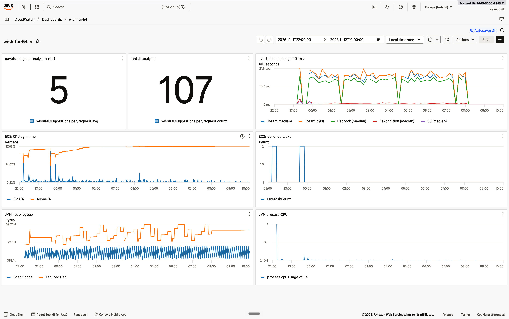
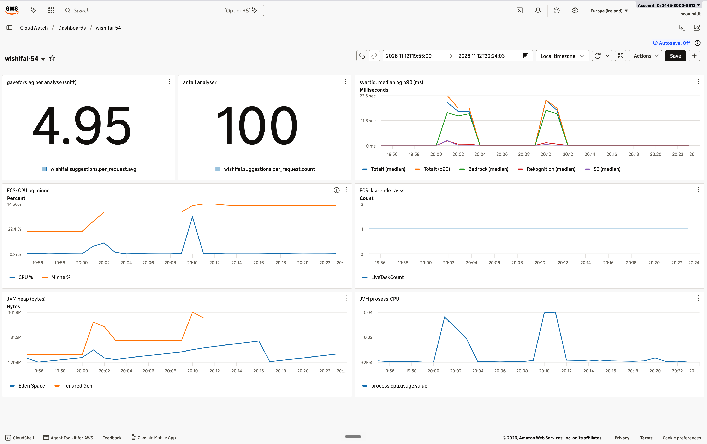
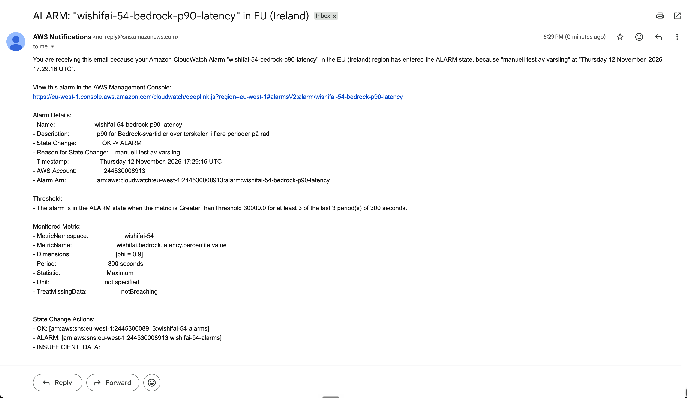

# README_SVAR.md - PGR301 Eksamen 2026

## Kandidatnummer: **54**

### Dokumentasjon for eksamensbesvarelsen i PGR301. 
Alle kommandoer kjøres fra rotmappen i repoet, hvis ikke noe annet står.

---

## Oppgave 1 - Container og CI

### 1A - Containerisér Spring Boot-applikasjonen

Slik bygger og kjører du appen lokalt:

```bash
cp .env.example .env          # legg inn egne AWS-nøkler
docker build -t wishifai .
docker run --rm -p 9999:9999 --env-file .env wishifai
curl -F "image=@samples/sample_image.png" http://localhost:9999/api/analyze
```

Dockerfilen er en multi-stage build. 
Byggesteget lager JAR-fila med Maven og JDK 21, og kjøresteget bruker bare en liten JRE 21 på Alpine. 
`pom.xml` blir kopiert før resten av koden, så avhengighetene blir cachet og nye bygg går raskere.

Appen kjører som en egen bruker uten root-rettigheter. Prosjektet har ingen tester, så builden bruker `-DskipTests`.

Appen lytter på port 9999 (`server.port=9999`), både lokalt og i ECS.
AWS-nøklene ligger i `.env`, og den fila er ikke i Git. Bare malen `.env.example` ligger i repoet.
I ECS bruker appen IAM task-rollen, ikke faste nøkler.

### 1B - CI-pipeline til ECR

*Vellykket kjøring:* [GitHub Actions Run](https://github.com/SeanMcKoi/PGR301-exam-solution/actions/runs/41046462788)

Pipelinen ligger i `.github/workflows/ci.yml` og starter ved push til `main`.
Den logger inn i AWS med nøkler fra GitHub Secrets, bygger imaget og pusher det til ECR-repoet `wishifai-54`.

Imaget får to tagger: commit-SHA og `latest`.

Commit-SHA-en viser nøyaktig hvilken kode som kjører, og gjør det lett å rulle tilbake. 
Pipelinen deployer alltid commit-SHA-en. `latest` er bare en snarvei til nyeste image. 
Semantisk versjonering trengs ikke, fordi hver push til `main` blir deployet direkte.

---

## Oppgave 2 - ECS Express med Terraform

### 2A - Infrastruktur for tjenesten

*Offentlig endepunkt:* [AWS ECS Service URL](https://wi-2b51b7f8849b40479605fee85ad716bc.ecs.eu-west-1.on.aws) ([healthcheck](https://wi-2b51b7f8849b40479605fee85ad716bc.ecs.eu-west-1.on.aws/actuator/health))

Appen har ingen nettside på `/`, bare API. Test den slik:

```bash
curl -F "image=@samples/sample_image.png" https://wi-2b51b7f8849b40479605fee85ad716bc.ecs.eu-west-1.on.aws/api/analyze
```

All infrastruktur ligger i `infra/` og settes opp med Terraform:

```bash
cd infra && terraform init && terraform apply && terraform output service_url
```

Region, kandidatnummer, image-tag og ECR-repo er variabler. 
Kandidatnummeret er med i alle navn, så ressursene mine ikke kolliderer med andres i en delt AWS-konto. 
ECS-tjenesten bruker standardrollene `ecsTaskExecutionRole` og `ecsInfrastructureRoleForExpressServices`. 
Den har healthcheck mot `/actuator/health`. Med `wait_for_steady_state = true` venter Terraform til tjenesten faktisk kjører.

S3-bøtta `wishifai-uploads-54` blokkerer all offentlig tilgang. Navnet sendes til containeren som miljøvariabel.
Task-rollen `wishifai-task-role-54` har bare de tilgangene appen trenger (least privilege):

- `s3:PutObject`, bare i min egen bøtte. Appen trenger ikke å lese fra S3, fordi Rekognition får bildet direkte.
- `rekognition:DetectLabels`
- `bedrock:InvokeModel`
- `cloudwatch:PutMetricData`

### 2B - Remote State og Versjonering

Terraform-state ligger i S3-bøtta `pgr301-terraform-state` med nøkkelen `wishifai/54/terraform.tfstate`.
`use_lockfile = true` låser state, så to kjøringer ikke kan endre den samtidig. Det krever Terraform 1.10 eller nyere.
`encrypt = true` krypterer state-fila. `.terraform.lock.hcl` ligger i repoet og låser AWS-provideren til versjon 6.71.0. 
Da bruker pipelinen og sensor samme versjon som jeg testet med i tilfelle det kommer nye versjoner før sensur.

### 2C - Terraform i GitHub Actions

*Vellykket kjøring:* [GitHub Actions Run - Terraform](https://github.com/SeanMcKoi/PGR301-exam-solution/actions/runs/42857588158)

Terraform-jobben kjører etter at imaget er pushet (`needs: build-and-push`).
Før `init` og `apply` kjører `terraform fmt -check -recursive`, så pipelinen feiler hvis koden ikke er riktig formatert.
Hvis bygget feiler, endrer ikke pipelinen infrastrukturen.
Terraform får image-taggen fra jobben før, så ECS peker alltid på et image som finnes i ECR.
Kjører Terraform før eller samtidig med bygget, kan ECS prøve å hente et image som ikke er pushet ennå. Da feiler deployen.
Rekkefølgen gir også en tydelig kobling mellom commit, image og deploy.

---

## Oppgave 3 - Observability

### 3A - Metrikker i applikasjonen

#### Oppsett

Appen bruker Micrometer og sender metrikkene til CloudWatch i namespace `wishifai-54`.
Namespace var tomt i `MetricsConfig`, og CloudWatch avviste derfor alle metrikkene.
Nå leser appen namespace fra `app.metrics.namespace`, med `wishifai-54` som standardverdi.

Hver metrikk blir laget i konstruktøren til tjenesten som gjør AWS-kallet.
Timeren ligger rett rundt kallet, så den måler bare selve kallet.
Derfor bruker jeg `Timer.builder` og ikke `@Timed`. `@Timed` måler hele metoden, også bygging av prompt og parsing av svaret.

#### Metrikker

**Minimumskrav:**

- `wishifai.rekognition.latency` (Timer): tiden for `DetectLabels`-kallet til Rekognition.
- `wishifai.bedrock.latency` (Timer): tiden for `Converse`-kallet til Bedrock.

**Business-metrikk:**

- `wishifai.suggestions.per_request` (DistributionSummary): antall gaveforslag i hvert svar. Én metrikk gir tre tall:
  - `count`: antall analyserte bilder. Tallet viser hvor mye tjenesten blir brukt.
  - `sum`: totalt antall gaveforslag.
  - `avg`: gaveforslag per analyse. Prompten ber om 5 forslag. Hvis snittet faller, gir modellen dårligere svar.
- Et svar med 0 forslag har likevel HTTP 200 og normal svartid. De tekniske metrikkene ser ikke den feilen, men denne metrikken gjør det.

**Ekstra metrikker:**

- `wishifai.s3.upload.latency` (Timer): tiden for opplasting til S3. Sammen med Rekognition og Bedrock forklarer den hele svartiden.
- `wishifai.image.size` (DistributionSummary, bytes): størrelsen på hvert bilde. Den viser om lang S3-tid kommer av store bilder.
- `wishifai.rekognition.labels` (DistributionSummary): antall labels per bilde. Få labels gir svakere grunnlag for gaveforslagene.
- `wishifai.bedrock.tokens` (Counter med tag `type=input/output`): tokens per kall. Bedrock tar betalt per token, så dette er en kostnadsmetrikk.
- `wishifai.bedrock.parse_errors` (Counter): svar der modellen ikke ga gyldig JSON. Dette er et kvalitetssignal.

De tre timerne publiserer også median og p90 med `.publishPercentiles(0.5, 0.9)`.
For Actuator-metrikken `http.server.requests` er det samme satt i `application.properties`.
Jeg bruker bare tags med faste verdier. Fritekst fra modellen som tag ville gitt en ny metrikk i CloudWatch for hver verdi.

Jeg valgte bort en egen teller for analyserte bilder. Actuator teller allerede kall til `/api/analyze`, og `count` over gir samme tall.

#### Funn: hvor blir tiden av?

Målt lokalt med 3 kall. Snittet per AWS-kall er hentet fra CloudWatch.

- Bedrock: 15,8 s (74 %)
- Rekognition: 3,2 s (15 %)
- S3: 2,3 s (11 %)

Summen er 21,2 s. Total svartid målt med `curl` var 21,3 s.
Bedrock er altså flaskehalsen, ikke S3, Rekognition eller selve appen.
Mulige tiltak er streaming av svaret, kortere prompt, en raskere modell eller S3-opplasting parallelt med analysen.

### 3B - Dashboard og alarm

#### Dashboard

Dashboardet heter `wishifai-54` og ligger i CloudWatch (eu-west-1). Koden ligger i `infra/dashboard.tf`.

**Metrikker på dashboardet:**

- **Business:** gaveforslag per analyse (snitt) og antall analyser. Begge kommer fra `wishifai.suggestions.per_request`.
- **Applikasjon, svartid:** median og p90 for `/api/analyze` fra Actuator, og median for Bedrock, Rekognition og S3 fra egne timere. Grafen viser hvor tiden blir av.
- **Applikasjon, JVM:** heap-minne (`Eden Space` og `Tenured Gen`) og CPU for JVM-prosessen fra Actuator.
- **Infrastruktur:** CPU, minne og antall kjørende tasks fra ECS.

Jeg bruker median og p90 i stedet for snitt. Ett tregt kall drar snittet opp.
Medianen viser hva en vanlig bruker opplever. p90 viser de tregeste kallene.

#### Reelle data i dashboardet

Dataene i dashboardet kommer fra dette skriptet, som jeg kjørte mot tjenesten i ECS over natten.
Skriptet sender to bilder hvert 10. minutt. `caffeinate -i` hindrer at Mac-en går i dvale.
Dashboardet åpnes på perioden med testtrafikk. Velg et annet tidsrom øverst til høyre for å se nyere data.

```bash
caffeinate -i bash -c '
  URL=https://wi-2b51b7f8849b40479605fee85ad716bc.ecs.eu-west-1.on.aws
  while true; do
    for img in sample_image sample_kidsroom; do
      echo "$(date +%H:%M) $(curl -s -o /dev/null -w "HTTP %{http_code} %{time_total}s" \
        -F "image=@samples/$img.png" $URL/api/analyze)"
    done
    sleep 600
  done' | tee -a ~/trafikk.log
```

Skriptet gikk fra 23:53 11.11 til 08:00 12.11.
Alle 94 kall ga HTTP 200, med svartid 14,0–21,2 s (snitt 17,6 s).



Skjermbildet viser perioden 22:00 11.11 til 10:00 12.11. Trafikken kommer fra testkall før midnatt og fra skriptet over.

**Hva dashboardet viser:**

- **Antall analyser:** 107 i perioden. Snittet er 5 gaveforslag per analyse, altså det prompten ber om.
- Bedrock-medianen ligger nesten på totalen. Rekognition og S3 ligger nær 0.
- CPU i ECS er under 1 %. Appen venter på Bedrock og jobber lite selv. Mer CPU gjør derfor ikke tjenesten raskere.
- Minnet er stabilt på ca. 28 %. Det er ingen tegn på minnelekkasje.
- Antall tasks gikk kort til 2 ved deploy. ECS starter den nye containeren før den stopper den gamle.

Datagrunnlaget er lite. Alle kall brukte de samme to eksempelbildene, og det er bare noen hundre kall fra én natt og to korte lasttester.
Tallene er derfor ikke nok til sikre konklusjoner. Noen antagelser er likevel rimelige, fordi de går igjen i alle målingene:

- Bedrock er flaskehalsen. Det stemmer både lokalt, om natten og under last, og det passer med at en språkmodell skriver svaret ett token om gangen.
- Appen venter mer enn den jobber. CPU er lav selv når svartiden er lang.

For sikrere tall trengs ekte trafikk over lengre tid, med ulike bilder.

#### Lasttest

Om natten behandlet tjenesten bare ett kall om gangen.
For å se hva som skjer under last, kjørte jeg to tester med samtidige kall (12.11 kl. 20:01 og 20:10).
`xargs -P` bestemmer hvor mange `curl`-kall som går samtidig.

```bash
URL=https://wi-2b51b7f8849b40479605fee85ad716bc.ecs.eu-west-1.on.aws

# Test 1: 40 kall, 5 samtidig
seq 40 | xargs -P 5 -I{} curl -s -o /dev/null -w "HTTP %{http_code} %{time_total}s\n" \
  -F "image=@samples/sample_image.png" $URL/api/analyze | tee ~/lasttest.log

# Test 2: 60 kall, 15 samtidig
seq 60 | xargs -P 15 -I{} curl -s -o /dev/null -w "HTTP %{http_code} %{time_total}s\n" \
  -F "image=@samples/sample_image.png" $URL/api/analyze | tee ~/lasttest2.log
```

Resultat (alle kall ga HTTP 200):

- **Natt, ett kall om gangen (94 kall):** median 17,6 s, p90 19,3 s, snitt 17,6 s.
- **5 samtidige (40 kall, ca. 2 min):** median 16,6 s, p90 20,6 s, snitt 17,3 s, maks 24,8 s.
- **15 samtidige (60 kall, ca. 75 s):** median 17,5 s, p90 22,1 s, snitt 18,3 s, maks 23,1 s.

Hva testene viser:

- Medianen er ca. 17 s på alle tre nivåene. Tiden per kall kommer av hvor lenge modellen bruker på svaret, ikke av antall samtidige kall.
- Bedrock struper ikke kallene (ingen throttling), og ingen kall feilet.
- p90 øker med lasten. Den første runden i hver test var tregest. I test 2 hadde de første 15 kallene snitt 21,9 s. De neste 45 kallene hadde snitt 17,1 s.
- Snittet økte bare fra 17,6 til 18,3 s. p90 viser tydeligere at noen brukere fikk lengre ventetid. Dette støtter valget av p90 i dashboardet og alarmen.
- Gjennomstrømningen økte fra 12 analyser i timen til ca. 48 i minuttet, med én task på 0,5 vCPU. Appen venter mest på Bedrock, så én liten container takler mange samtidige kall.

Dashboardet under lasttestene (19:55–20:24, svartid med periode 1 min):



- **Antall analyser:** 100, altså 40 + 60 kall.
- **Gaveforslag per analyse:** 4,95. Minst ett svar under last hadde færre enn 5 forslag.
- **Svartid:** det første minuttet i hver test er tregest, med median ca. 20–21 s og p90 opp mot 23,6 s. Etterpå faller begge til ca. 16–18 s. Bedrock ligger jevnt på 14–16 s.
- **ECS CPU:** ca. 8 % i test 1 og ca. 35 % i test 2. CPU øker med lasten, men er langt fra full.
- **ECS minne:** økte fra ca. 22 % til ca. 45 % og ble liggende der. JVM-en beholder heap-minnet den har tatt.
- **Kjørende tasks:** 1 hele tiden. Én task var nok, så ECS trengte ikke å skalere ut.

Konklusjon: mer kapasitet i ECS gjør ikke hvert svar raskere.
For å korte ned svartiden må jeg endre selve Bedrock-kallet, for eksempel med streaming, kortere prompt eller en raskere modell.
Jeg stoppet på 15 samtidige kall, siden Bedrock-kvoten deles.

#### Alarm

Alarmen `wishifai-54-bedrock-p90-latency` ligger i modulen `infra/alarm_module/`. Filen `infra/alarm.tf` kaller modulen.

- **Metrikk:** p90 for Bedrock-svartid (`wishifai.bedrock.latency.percentile.value` med `phi=0.9`).
- **Terskel:** over 30 000 ms i 3 perioder på 5 minutter på rad.
- **Varsel:** SNS-topic med e-post. Alarmen sender også e-post når den går tilbake til OK.

Bedrock står for ca. 75 % av svartiden. Hvis Bedrock blir tregere, merker brukerne det med en gang.
p90 ligger normalt på 18–20 s, så 30 s er en tydelig forverring.
Tre perioder på rad hindrer falsk alarm fra ett enkelt tregt kall.
Uten trafikk går ikke alarmen (`treat_missing_data = "notBreaching"`).

Modulen har standardverdier for terskel og perioder. Den som bruker modulen, gir bare prefiks, namespace og e-post.
E-postadressen har ingen standardverdi og ligger ikke i repoet. Pipelinen henter den fra GitHub-secreten `ALARM_EMAIL` som `TF_VAR_alarm_email`.

**Test av alarmen:**

```bash
aws cloudwatch set-alarm-state --alarm-name wishifai-54-bedrock-p90-latency \
  --state-value ALARM --state-reason "manuell test av varsling"
```

E-posten kom innen ett minutt. Testen viser at kjeden alarm, SNS, e-post virker.



---

## Oppgave 4 - Drøfteoppgave

En AI-tjeneste kan svare med 200 OK og lav latency, men likevel generere svar som er upassende, misvisende eller skadelige. Med generativ AI holder det derfor ikke at DevOps bare fanger opp downtime og crashes. Vi må også fange feil i innholdet modellen lager, både i pipeline og i prod.

Innen testing fungerer ikke klassiske unit tests med ett fasitsvar, siden en språkmodell svarer ulikt fra gang til gang. Vi må i stedet teste egenskaper ved svaret. Noen er enkle å sjekke automatisk, for eksempel at svaret er gyldig JSON med fem forslag. Wishifai har en workflow der koden styrer stegene, ikke modellen. Svaret kan derfor sjekkes i koden før brukeren ser det, for eksempel mot en liste med forbudte gavekategorier. Andre, som om forslagene er relevante og trygge, er vanskeligere. Til dette kan vi bruke et fast eval-sett med en kvalitetsterskel i pipelinen. Svarene kan vurderes av en annen språkmodell (LLM-as-a-judge), men den kan også ta feil, så vi trenger manuelle stikkprøver i tillegg. Wishifai har ingen slike tester i pipelinen i dag, så et enkelt eval-sett er et konkret forbedringspunkt.

Når det gjelder kontinuerlig leveranse, ligger prompten i `BedrockService.java`. Den følger altså image-taggen, versjonstyres i Git og kan rulles tilbake. Modell-ID-en kan derimot byttes via miljøvariabelen `BEDROCK_MODEL_ID` utenom pipelinen. Et modellbytte kan endre svarene like mye som en ny prompt, og bør behandles som en risikabel release med gradvis utrulling via canary eller A/B-testing.

På overvåkingssiden fanger alarmen fra oppgave 3B opp at Bedrock svarer tregt, men ikke at modellen foreslo en kniv i gave til en femåring. Metrikker som `parse_errors`, `suggestions.per_request` og token-usage leser ikke innholdet, men gir tidlige signaler om at kvaliteten faller eller at svarene endrer seg over tid. Kodesjekken fanger bare flagg vi kjenner på forhånd. For å fange nye typer upassende forslag trengs brukerrapporter og jevnlige stikkprøver fra produksjon.

Praksisene må også tilpasses risikonivået. For en gaveliste-app som Wishifai er automatiske kvalitetsporter og feedback i prod godt nok. I en bank måtte vi hatt fagfolk til å lage eval-settene, formell godkjenning av endringer i prompt og modell, og et menneske i loopen der en rådgiver godkjenner svaret før kunden ser det. Det gjør leveransen tregere og bryter med DevOps-idealet om rask flyt, men når et feil råd kan forårsake økonomisk tap for kunden, er det verdt prisen.

Så DevOps-prinsippene gjelder fortsatt. Forskjellen er bare at det ikke lenger holder at tjenesten virker teknisk. Svarene fra modellen må også være riktige. Jo større skade et feil svar kan gjøre, jo strengere kontroll trengs.
